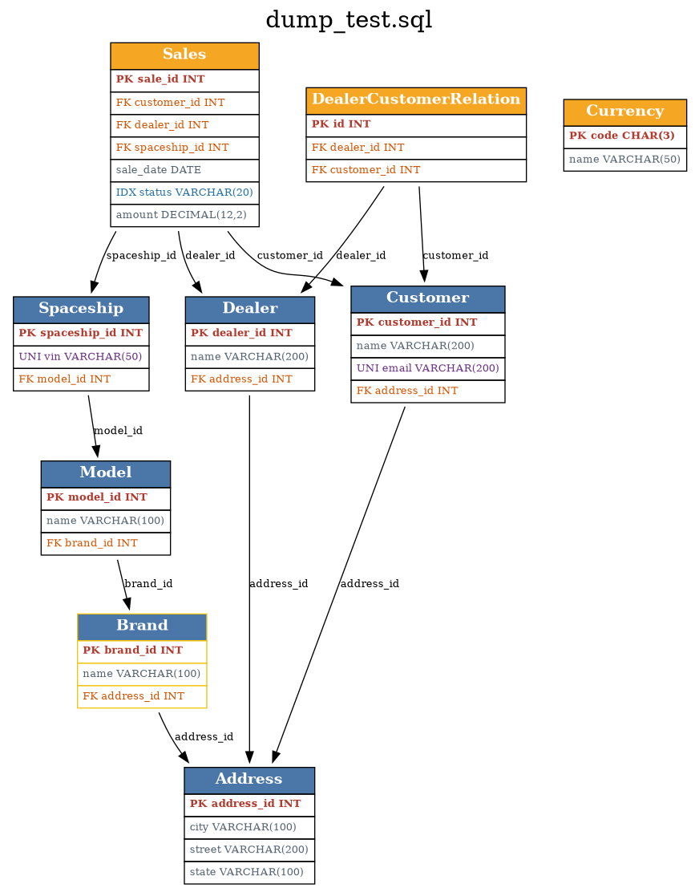

# schema-visualizer

Анализ схемы базы данных по MySQL-дампу — за одну команду.

Вместо получаса листания SQL-файла глазами: положите дамп рядом и запустите
скрипт — получите структуру таблиц, дерево связей, отчёт по индексам и схему
в PNG для быстрого знакомства с базой.



## Что делает

- **Структура таблиц в формате mysql-клиента** — DESC-таблицы с рамками,
  колонками Field/Type/Null/Key/Default/Extra; `PRI`/`UNI`/`MUL` расставлены
  как у настоящего `mysql> DESC`.
- **Дерево внешних ключей** — от таблицы фактов вниз к справочникам,
  с пометками «уже показана выше», циклами и сиротами.
- **Сироты** — таблицы без единой связи (частый признак забытой таблицы)
  помечаются и отделяются пустой строкой.
- **Отчёт об анализе индексов** — все индексы по таблицам, плюс две проверки:
  внешние ключи без индекса (грозят полным сканированием на JOIN) и
  избыточные индексы (чей состав покрывается префиксом другого).
- **Схема в Graphviz** — `имя_дампа.dot` и `.png`: каждая таблица со столбцами
  и раскраской ключей (PK — красный, UNI — фиолетовый, FK — оранжевый,
  индексы — синий), таблицы с FK без индекса — с жёлтой рамкой. Имя дампа
  печатается заголовком вверху схемы.

## Требования

- Python 3.7+ (без сторонних библиотек)
- Graphviz — только для PNG: `sudo apt install graphviz` (без него DOT
  всё равно сохраняется, отрисовать можно позже)

## Использование

```bash
py schema_sql.py dump.sql          # с аргументом
py schema_sql.py                   # или интерактивно: скрипт попросит имя
```

Имя файла можно вводить без расширения `.sql` — подставится само.
Если файла нет, скрипт покажет список доступных дампов в папке.

Быстрый старт с примером:

```bash
py schema_sql.py examples/dump_test.sql
```

## Пример вывода

```
Дерево связей (направление: от таблицы фактов вниз, к справочникам):

Sales
|-- Customer
|   \__ Address
|-- Dealer
|   \__ Address (уже показана выше)
\__ Spaceship
    \__ Model
        \__ Brand
            \__ Address (уже показана выше)

Currency (сирота, нет связей с другими таблицами)
```

## Как это устроено

Парсер разбирает дамп с учётом вложенных скобок и строковых литералов
(`split_top`), поэтому не ломается на `ENUM('a','b')` и дефолтах с запятыми.
Поддерживаются связи и индексы как внутри `CREATE TABLE`, так и в
`ALTER TABLE ... ADD FOREIGN KEY / ADD KEY`.

## Идеи для развития

- поддержка PostgreSQL и SQLite
- разбор типов колонок в отдельные категории
- фильтр DESC по таблицам (только крупные)
